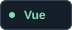
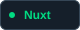

# Привет, я Павел 👋

**Frontend-разработчик. Превращаю сложные задачи в интерфейсы, которыми приятно пользоваться.**

Создаю проекты, в которых есть за что зацепиться: интересная идея, выразительная графика, продуманные детали. Люблю момент, когда смелое «а что, если?» становится работающим продуктом — и его уже можно открыть в браузере.

Моя стихия — JavaScript, TypeScript и Vue. Мне интересно делать сложные данные понятными, оживлять интерфейсы и находить изящные решения там, где сначала виден только клубок требований.

**<a href="https://focusinfo.ru/portfolio" target="_blank" rel="noopener noreferrer">Посмотреть портфолио ↗</a> · <a href="https://focusinfo.ru" target="_blank" rel="noopener noreferrer">Заглянуть на мой сайт ↗</a>**

## Что я создаю

- **Интерфейсы, которые помогают разобраться.** Дашборды, таблицы и графики: от массива данных до понятной картины и нужного действия.
- **Веб-приложения с характером.** Продуманные сценарии, отзывчивое взаимодействие и детали, которые хочется замечать.
- **Браузерные расширения.** Полезные инструменты рядом с привычными сайтами — меньше рутины, больше возможностей.
- **Интерактивную графику и карты.** Когда идею лучше показать, дать покрутить, приблизить и исследовать самому.

Для меня классный проект складывается из двух ощущений: «ого, так можно было?» при знакомстве и «как же удобно» при ежедневном использовании. Именно такие проекты я люблю делать.

## Мой рабочий набор

| Задача | Инструменты |
| --- | --- |
| Состояние и сборка | Pinia, Vuex, Vite, Webpack |
| Интерфейсы и стили | Tailwind CSS, Sass, Storybook |
| Качество и проверка | Vitest, Jest, Playwright, код-ревью, рефакторинг |
| Данные и обновления в реальном времени | AG Grid, ECharts, ApexCharts, WebSocket, Socket.io |
| Графика и карты | Three.js, PixiJS, Canvas, OpenLayers, Leaflet |
| Браузерные расширения | WXT |

## Проекты, которые можно открыть

Лучше один раз попробовать: мои работы живут за пределами скриншотов.

- **<a href="https://focusinfo.ru/portfolio" target="_blank" rel="noopener noreferrer">Портфолио</a>** — отправная точка для знакомства с моими работами.
- **<a href="https://focusinfo.ru" target="_blank" rel="noopener noreferrer">Focusinfo</a>** — мой сайт и точка входа в проекты.

## Давайте сделаем что-нибудь невероятное

Люблю идеи, от которых сначала любопытно, а потом уже невозможно оторваться от реализации. Если у вас есть такая — буду рад познакомиться и обсудить, как превратить её в живой проект.

**<a href="https://focusinfo.ru" target="_blank" rel="noopener noreferrer">Мой сайт ↗</a> · <a href="https://focusinfo.ru/portfolio" target="_blank" rel="noopener noreferrer">Портфолио ↗</a>**
